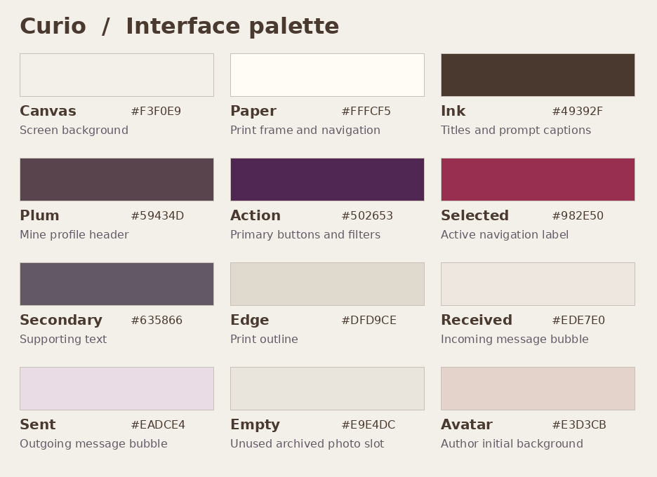

# Curio · Color and dimensions

## Light appearance

Use these sRGB hex values as named colors in the Xcode asset catalog. The thread’s placeholder tiles draw colors from the contributed photos; the fixed colors below belong to the interface.

| Color name | Hex | Use |
|---|---|---|
| Canvas | `#F3F0E9` | Screen background |
| Paper | `#FFFCF5` | New/open print frame and navigation; active frames interpolate toward Action as the deadline approaches. |
| Ink | `#49392F` | Titles and prompt captions |
| Plum | `#59434D` | Mine profile header |
| Action | `#502653` | Primary buttons and filters; final print-frame color at expiry and for saved journals. |
| Selected | `#982E50` | Active navigation label |
| Secondary | `#635866` | Supporting text |
| Edge | `#DFD9CE` | Print outline |
| Received | `#EDE7E0` | Incoming message bubble |
| Sent | `#EADCE4` | Outgoing message bubble |
| Empty | `#E9E4DC` | Unused archived photo slot |
| Avatar | `#E3D3CB` | Author initial background |

## Layout dimensions

These are measurements from the current browser prototype in CSS pixels. Use the same numeric values in SwiftUI points as an initial iPhone layout, then test with safe areas and Dynamic Type. Image sizes follow the available content width.

| Element | Initial iOS dimensions |
|---|---|
| Screen content | 22 pt horizontal inset, 16 pt top, 20 pt bottom. Put bottom navigation above the safe area. |
| Discover and Mine | Two flexible columns. 14 pt between columns, 18 pt between rows. Card width = (available width − 44 − 14) / 2. |
| Thread print | 1 pt outer outline and 7 pt inner padding above and beside the square. At 390 pt screen width, each card is 166 pt wide with a 150 × 150 pt photo area. |
| Deadline frame | Over the round-one 600-second lifetime, interpolate the print frame from Paper `#FFFCF5` toward Action `#502653`. Saved/expired prints remain Action with a light prompt caption for contrast. |
| Photo collage | Square aspect ratio; 1 pt internal seams. At 150 pt wide, a 2×2 tile is 74.5 pt and a 3×3 tile is about 49.3 pt. All tiles share one paper frame. |
| Prompt caption | At least 38 pt high including 5 pt padding. Centered 15 pt italic serif. Grow the paper margin for a wrapping prompt. |
| Author and metadata | 19 pt initial avatar, 5 pt gap to the 12 pt author name; 11 pt metadata. First page title 26 pt. |
| Inbox row | 55 pt print thumbnail, 12 pt gap to the title and preview, 14 pt vertical padding, 1 pt divider. Thumbnail padding 3 pt above and beside the photo, 7 pt below. |
| Conversation | 12 pt between entries. Posted photo 118 pt square including its frame. Bubbles up to 78% of available width with 8 pt vertical and 12 pt horizontal padding. |
| Journal detail | Three equal columns, 4 pt gaps, square tiles with 7 pt corner radii. Center the viewer’s contribution in cell five. |
| Mine profile header | 18 pt horizontal and 14 pt vertical padding. |
| Bottom navigation | 8 pt outer padding, 13 pt label. For native controls use at least a 44 × 44 pt hit area and scale text with Dynamic Type. |

The 390 pt example uses the prototype's edge-to-edge mobile viewport. Final native typography at accessibility sizes and dark-appearance colors are open design decisions.

[Current page decisions and open questions](../../prototype/round1/UI_INVENTORY.md) · [Prototype stylesheet](../../prototype/round1/ui/style.css)
