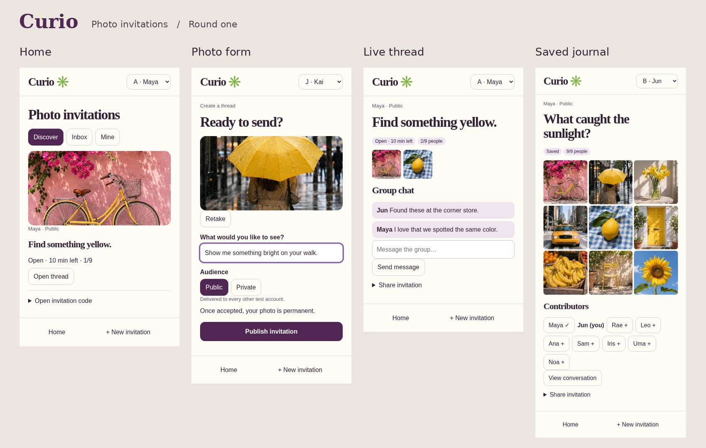

# Build Curio’s first iOS prototype

Curio is a shared photo journal. Maya photographs a yellow bicycle and asks “Find something yellow.” Jun opens the invitation and sees the bicycle. When Jun adds a photo of a lemon, Jun takes the second of nine places and can speak in the thread. Ten minutes after Maya published, both can reopen the journal. Maya sees the bicycle in the center of the cover. Jun sees the lemon in the center. Both see the same photos and chat history.

**Your assignment:** implement this exchange between two independent SwiftUI clients using Firebase. Submit a runnable Xcode target, an emulator-backed service and evidence that the acceptance cases below pass. Use [the round-one rules and data contract](README.md) for implementation decisions. The original concept proposal and older backend briefs describe earlier versions.



## Try the reference in five minutes

From a checkout, run the following, then open [the prototype on localhost](http://localhost:8000). It runs on a computer with Python 3 and a browser. The phone-shaped area is the app. The account selector and clock controls are test tools.

```sh
git clone https://github.com/Joyful-coder-x/Curio_2026_swift_moblie.git
cd Curio_2026_swift_moblie
python3 -m http.server 8000 --bind 127.0.0.1 --directory prototype/round1/ui
```

1. Start as B · Jun. Open Maya’s yellow invitation. Choose **Add a photo**, pick a sample or your photo, review it, then **Use this photo → Send photo & join**. Send a chat message.
2. Switch to A · Maya. Open the same thread from Mine. See Jun’s photo and message, then reply.
3. Click **Advance clock 10 min**. Open the conversation in the journal. Switch back to Jun, choose Mine, and reopen it. Compare the center photos.
4. To try creation, switch to J · Kai and choose **+ New invitation**. Pick a photo, confirm, enter a question, leave Public selected and publish. Switch to another account and check Inbox. To see a complete cover immediately, open “What caught the sunlight?” in Maya’s Mine.
5. For Private, start a fresh fixture with **Reset sample data**, switch to B, open the saved journal and use the “Rae +” contributor button to follow C · Rae. As Rae, publish a private invitation. Check B’s Inbox, then J’s Inbox. As Rae, open **Share invitation** and give J the code. As J, use Home → **Open invitation code**. Viewing, joining and messaging are three separate actions.

The browser stores fixtures and photos in this browser profile. Use the account selector in one tab for the walkthrough. Bookmarked links reference this local dataset. Real cross-device delivery, access control, offline recovery and simultaneous submissions are part of the Swift/Firebase assignment.

## Screen contract

| Screen | What to render | Action and outcome |
|---|---|---|
| Home | Discover, Inbox and Mine within one screen. Cards show the opening photo, prompt, author, visibility, count and time/status. | Discover lists eligible open invitations. Inbox shows deliveries and activity on the viewer’s threads, latest photo activity first. Mine groups history by thread and identifies created/joined. Selecting a card resolves its current permissions and opens the same thread ID, including after archival. |
| Photo form | Camera or photo library, preview, retake and confirm. Create mode asks for a one-line prompt (140 characters in the reference) and Public/Private. Join mode shows the existing prompt. | Require a confirmed photo and, for creation, a nonblank prompt. Warn that accepted photos are permanent. Disable duplicate submission while pending. Retain draft on failure. Navigate only after server acceptance. |
| Live thread | Prompt, photo strip, member count, remaining time, invitation link and text conversation for members. | An eligible visitor can submit one photo. The accepted photo creates membership. At nine photos hide Join and remove the card from Discover. Members can still chat until the deadline. A direct link to a full thread still opens for an authorized viewer. |
| Saved journal | Prompt, 3×3 cover, contributor names, share action and an expandable chat history for members. | At the deadline route to this view even when fewer than nine people contributed. Place the viewer’s own photo in the fifth cell, or the opener’s for a visitor. Fill remaining cells in acceptance order. Keep unused cells empty. A follow changes future discovery and delivery. |

For loading, show a pending state. For an empty feed, offer New invitation. For an expired or full thread reached from a stale card, refresh the route and show the current state. On a lost acknowledgement retry the same request ID. Never show chat text to an unjoined viewer, including while switching accounts.

## Rules to implement on the server

- Give each signed-in person one publication per UTC day and one contribution per thread. Count the creator’s opening photo as the first contribution. Following and link redemption grant private viewing independently. Neither consumes a photo slot.
- Public is the default. Publish an in-app inbox reference to every other registered tester, including offline testers. The creator’s reference belongs in Mine. For Private, deliver only to current followers. A signed-in link holder can redeem the link and view without receiving a broadcast. A bare private thread ID cannot grant access.
- Use server time. Set the round-one deadline to publication + **600 seconds**. The normal product setting is **12 hours**. Persist the deadline on creation. From 0 through 599 seconds, members may chat. At or after 600 seconds, reject new photos and messages and retain member-only conversation history.
- Accept a maximum of **nine distinct contributors**. Accepted photos cannot be edited, replaced or withdrawn. Failure, replay and simultaneous joins must preserve that constraint. Use the same thread ID for the journal and share route.

## Suggested implementation order

1. **Identity and fixtures.** Connect development builds to Firebase Auth, Firestore, Storage and Functions emulators. From this directory run `python3 seed_auth.py` with Auth at port 9099. It prints UIDs for accounts A–J. Seed those UIDs as active users, set B to follow A, and supply separate fresh fixtures for public, private, eight occupied places and near-expiry tests. The test switcher uses real, separate Auth sessions.
2. **Publish and join.** Use Firestore for thread metadata, membership, deliveries, link grants and chat. Store JPEG bytes in Cloud Storage. Read the exact paths, allowed writes, indexes to query and file restrictions in the [Firebase contract](README.md#firebase-contract). Use a callable to prepare the pending upload. Upload once, then confirm via a callable/transaction. On acceptance attach the immutable asset, allocate the slot, update count/status and write membership together. Use an idempotency key per logical operation.
3. **Read and route.** Implement a SwiftUI navigation stack with Home, PhotoForm(create/join), Thread(id) and Journal(id). A small thread repository owns the Firebase listeners and callable adapters. Keep the draft image and pending/error state in the form. Use a deep-link handler to redeem a share token after sign-in. Keep chat listeners active only for accepted members. Remove old subscriptions when changing accounts.
4. **Suggested callable surface.** Implement preparePhoto, publishThread, joinThread, redeemInvite, setFollow and sendMessage, or equivalent names. Derive UID from authenticated context. Return thread ID and deadline on publication and existing result on exact replay. Handle unavailable access, full thread, deadline passed, prior contribution, daily limit and failed upload distinctly so the client can show the correct next action.
5. **Validate storage and permissions.** [Firestore rules](firestore.rules) and [Storage rules](storage.rules) are starting drafts. Exercise them with authenticated and unauthenticated clients in emulators. The [SQL schema](model.sql) and `python3 prototype/round1/check_model.py` from the repo root form a local reference for relationships and constraints. Firebase is the shared runtime database.

## Acceptance and delivery

| Run this test | Pass condition |
|---|---|
| Two clients, A and B | A publishes; B receives exactly one reference, joins and sends a message. A sees both updates without manually refreshing. After relaunch both can reopen the thread. |
| Ten accounts | Public by A reaches B–J, including a tester who was offline. For private by A in a fresh fixture, only follower B is notified. J is denied by bare ID and photo path, then redeems a valid link and sees the photo. Chat stays locked until J contributes. |
| Ninth place | With eight photos accepted, I and J submit concurrently. Exactly one succeeds. Nine unique photos remain; the thread leaves Discover. Members can still send text at second 599. |
| Deadline | At second 600, partial and full fixtures both open as journals at their original IDs. A late join and a late message are rejected by the backend. Old messages remain visible only to members. |
| Archive and failure | A and B see their own photos in the center. A visitor sees the opener in the center and no chat. Invalid uploads, duplicate taps and retries cannot consume an extra place. Accepted media cannot be replaced or deleted by a client. |

Return the Xcode target and backend source, emulator start/seed commands, the rules and required indexes, and a short two-client recording with an acceptance checklist (pass/fail and any known failures). Prioritize this exchange before adding OS notifications, feed ranking, QR scanning or a separate profile/settings page.
