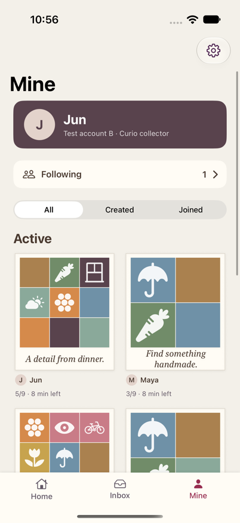
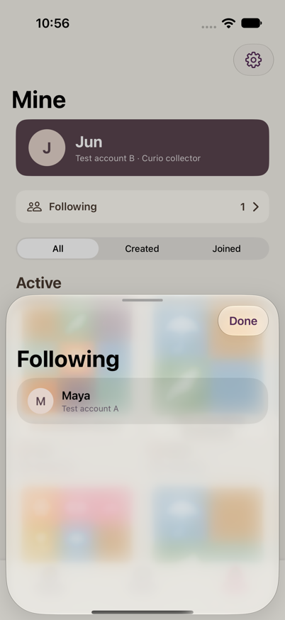
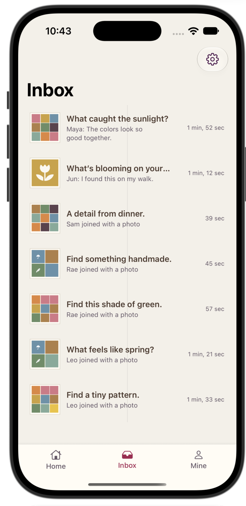
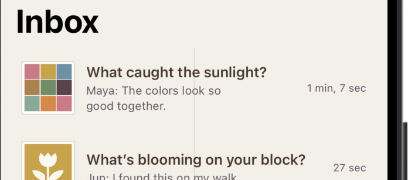
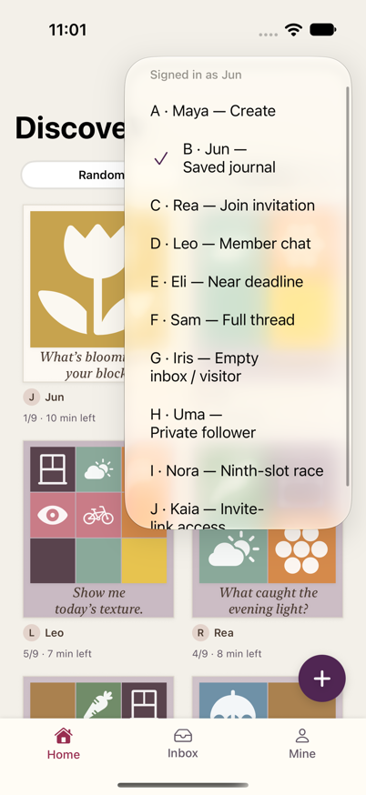
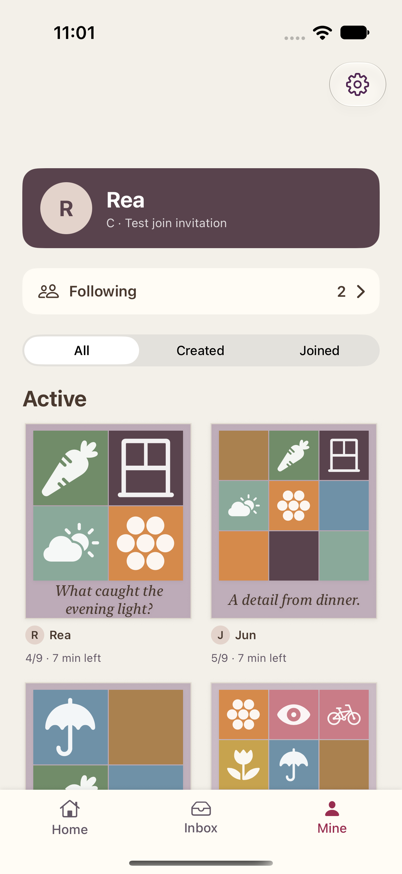
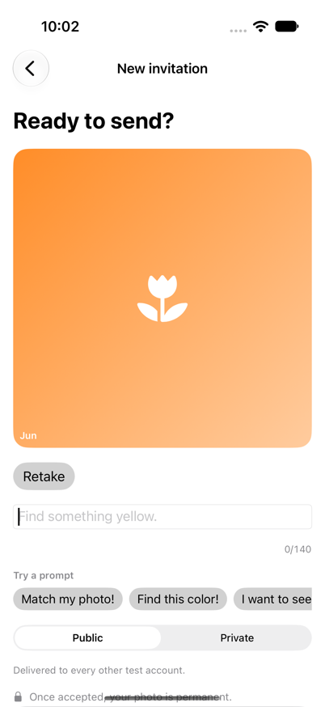

# Curio Round 1 — Progress Dialogue

Updated: November 19, 2026 (America/New_York)

## Current redesign in progress — Discover visual standard

The latest Round One direction replaces the earlier card-list home with the repository's `Discover.jpg` and `Curio_Visual_Guide.md` as the visual acceptance standard. Work currently in progress includes:

- A shared Polaroid/thread component with one-image, 2×2, and 3×3 collage modes.
- A 25-thread, two-column Discover fixture matching the 390 pt measurements.
- Bottom Home / Inbox / Mine navigation and a top-right settings gear containing the A–J simulator account switcher.
- One-row-per-thread Inbox treatment, chronological mixed photo/message timelines, Mine filters, and personalized archived journal covers.
- Four saved simulator screenshots and A/B, capacity, expiry, and final-submit regression evidence.

The fixture/data model, shared Polaroid collage, Visual Guide color tokens, two-column Discover shell, bottom navigation, settings account menu, local Random/Following filter, Mine Following sheet, and deadline-sensitive paper tint are now implemented. Xcode diagnostics are clear and the full project builds successfully. The thread timeline and Journal redesign, four final simulator screenshots, and complete acceptance tests are not yet complete and must not be treated as delivered until a later verification entry says so.

### Latest checkpoint

- Build: **Pass** — full Xcode build completed without errors after the Following and deadline-frame changes.
- Discover: **focused simulator pass** — Random is the default; B's Following feed contains exactly three open Maya/A threads and no unfollowed creators.
- Mine: **focused simulator pass** — B shows Following 1 and the sheet lists only Maya/A.
- Inbox: one-row-per-thread layout is visible, but the center-divider visual bug remains documented and actual JPG fixture photos are not yet connected.
- Photo flow: square crop, preview, prompt suggestions, and final-submit guard remain present from the previous verified build.
- Thread/Journal: still use portions of the earlier UI and require the requested chronological timeline and shared archived Polaroid pass.
- Firebase/private access: still presentation-only and not secure; emulator repository, follower writes, invitation redemption, and rules enforcement remain future work.

The detailed working/partial/not-working matrix is saved in [Curio current UI flow audit](../progress/Curio_UI_Flow_Audit_2026-11-19.md).

### Latest simulator screenshots

| Discover Random | Discover Following |
|---|---|
|  |  |

| Mine | Following list |
|---|---|
|  |  |

### Original directions and response summaries

#### Round One SwiftUI redesign

**User command (verbatim)**

> 请在现有 cuiro round1.xcodeproj 里修改 Round One 的 SwiftUI 界面。以任务单链接中的 Discover 最新截图为首页标准，以 Curio Visual Guide 为颜色和尺寸标准。按以下顺序实施：
> 1. 先做一个共用的拍立得组件。 一个 thread 对应一张相纸。上方是正方形拼图，下方白边内放 prompt，作者、人数和剩余时间放在相纸外。1 张照片用单图，2–4 张用四宫格，5–9 张用九宫格。进行中的空位用稳定的照片色块填充。Home、Inbox 缩略图和 Mine 复用同一套拼图逻辑。
> 2. 改 Discover。 去掉顶部 Curio 横幅和星星，使用可连续下滑的双列照片流，底部放 Home、Inbox、Mine。准备约 25 条示例 thread。以 390 pt 屏宽验收：左右边距各 22 pt，列间距 14 pt，每张卡宽 166 pt，内部图像为 150 × 150 pt。每张卡显示作者、实际参与人数和剩余时间。
> 3. 改 Inbox 和群聊。 每个 thread 只占一行，显示 55 pt 拼图缩略图、prompt、最近动态和时间。点开后按时间混排照片和消息：有人加入，就自动出现姓名和新照片；自己发的气泡靠右，别人发的靠左。未加入的用户只能看邀请摘要。
> 4. 改 Mine 和 Journal。 Mine 上方放个人信息，下方用 All / Created / Joined 筛选，并分成 Active 和 Saved journals。归档后一律显示九宫格，当前贡献者的照片在正中央，空位留白。成员可以重看聊天记录。
> 5. 回归测试并交付。 用 A 发起、B 加入，验证照片和消息顺序、满 9 人退出 Discover、10 分钟后归档，以及 A、B 打开同一本日记时各自照片居中。特别检查已有的提交保护：确认裁切后进入预览，只有再点最终提交才会发布或加入。 最后提交可运行的 Xcode 改动、四张模拟器截图和测试结果。

**Assistant response/action summary:** Audited the current repository against `Discover.jpg`, the Visual Guide, and the Round One contract; began the shared collage and fixture redesign, with screen completion and simulator acceptance still in progress.

#### Settings account switcher

**User command (verbatim)**

> also, change the switch acound button to a setting gear logo on top right with the option to log into other account in it, so the UI

**Assistant response/action summary:** Moved the A–J simulator account choice into the active redesign's top-right settings gear and removed the large account card from the planned content layout.

#### Before-and-after simulator documentation

**User command (verbatim)**

> also when you are coding can you ass screen show to the simluate in the progress defore and after you make sugnificate changes? also save it as progress ducmation

**Assistant response/action summary:** Established a before/after simulator screenshot workflow, saved the first regression pair in `docs/progress/screenshots/`, and linked it from this document.

Future progress entries will pair the exact user command that caused a material implementation change with a summary of the assistant's actual response and outcome. The chronological [Curio AI Dialogue](Curio_AI_Dialogue.md) remains the complete instruction record.

#### Audit the current UI flow

**User command (verbatim)**

> go through the user UI flow that should be set up by current version, save screen shot of what is happending, and document what is working/notworking

**Assistant response/action summary:** Confirmed that the project builds and started a simulator-based current-state audit covering Discover, settings, Inbox, Mine, create/confirm, visitor/member thread behavior, and Journal; the final evidence report is still in progress.

#### Inbox center-divider issue

**User command (verbatim)**

> [Attached image: Screenshot 2026-11-19 at 10.43.48 PM.png]
>
> why is there a thin line in the very center

**Assistant response/action summary:** Identified that a `Divider` attached to the row `HStack` resolves vertically and stacks into a center line; documented the required explicit one-point horizontal separator fix.

#### Inbox fixture-photo limitation

**User command (verbatim)**

> [Attached image: Screenshot 2026-11-19 at 10.44.33 PM.png]
>
> why is the image not showing

**Assistant response/action summary:** Confirmed that current fixture contributions contain colors and SF Symbols with `imageData: nil`; actual repository JPG samples are not yet bundled and assigned to the 25 native fixture threads.

#### Add screenshots to progress

**User command (verbatim)**

> can you add photo to progress

**Assistant response/action summary:** Saved both user-provided Inbox screenshots in `docs/progress/screenshots/` and embedded them beside their diagnosed issues in this progress document.

#### Public versus private audit

**User command (verbatim)**

> do current version handle provate vs public?

**Assistant response/action summary:** Reported that the picker and local `isPrivate` value exist, but following delivery, invite redemption, viewer grants, Discover filtering, Firebase Auth, and server/rules enforcement are not implemented, so private mode is not secure.

#### Discover Following filter and Mine list

**User command (verbatim)**

> in discover add button to swich from random to follwed, and, also in Mine, add a button to see who I folloed

**Assistant response/action summary:** Added a Random/Following segmented control to Discover and a Following row and sheet in Mine, backed by temporary account-specific fixture relationships with B following A; the Xcode build passes and simulator verification is in progress.

#### Deadline-sensitive Polaroid frames

**User command (verbatim)**

> add this: for that are closer to deadline(10min) make the color darker, that is the closer it is to the 10 mmin deadline, the more close it is to 502653, the apply to the white frame of the images

**Assistant response/action summary:** Changed active Polaroid paper frames to interpolate from warm paper toward `#502653` as the ten-minute deadline approaches, including compact Inbox thumbnails, while keeping archived paper light and maintaining caption contrast.

#### Keep progress documentation current during work

**User command (verbatim)**

> updata the progress along the way

**Assistant response/action summary:** Updated this document immediately with the latest successful build, completed UI pieces, saved evidence, known issues, and the simulator checks that remain in progress, and will continue doing so at material checkpoints.

#### Reorganize simulator accounts by test scenario

**User command (verbatim)**

> change the name of the tester account, to Maya(create) , Jun(test save), Rea(test join) etc.... so basci reorgnize these account and set up to a place that is easy to test different feture

**Assistant response/action summary:** Labeled stable accounts A–J with explicit Round One roles—create, saved journal, join, member chat, near deadline, full thread, empty Inbox/visitor, private follower, ninth-slot race, and invite-link access—then simulator-verified all menu labels and C/Rea's Mine role.

| Scenario account menu | C/Rea join-test profile |
|---|---|
|  |  |

#### Retry the GitHub push

**User command (verbatim)**

> can you push now?

**Assistant response/action summary:** Committed this push request with the current verified checkpoint and retried pushing `main`; the resulting remote status is reported in the accompanying response.

This document records what Round 1 started with, what changed, what failed, how those problems were addressed, and which parts are intentionally temporary. It is a development handoff, not a claim that the production Firebase or multi-iPhone version is complete.

## Screenshot documentation practice

For each significant visible UI change:

1. Capture the relevant simulator screen before editing when a reproducible before state is available.
2. Make and build the scoped change.
3. Reopen the same simulator state and capture the after screen.
4. Save both images in `docs/progress/screenshots/` with a date and descriptive name.
5. Add the pair to this document with the behavior tested, not only a visual description.

Small code-only fixes that do not change a screen may be recorded without screenshots. If a reliable before state cannot be recreated, the entry must say that instead of presenting a different state as the before image.

## What we started with

- A newly created Xcode project that initially appeared in Xcode's navigator without an active app target or scheme.
- A four-screen product direction: Home, Photo Form, Live Thread, and Saved Journal.
- A Firebase contract for Auth, Firestore, Storage, callable Functions, access rules, expiry, and concurrency, but no verified end-to-end Firebase integration in the iOS target.
- A browser reference flow and repository examples for camera, photo-library, Firebase, buttons, and storage.
- The decision to use the Firebase Emulator Suite, simulator-only signing, and two iOS simulators for the first acceptance pass.

## What has changed

### Xcode and simulator prototype

- Created a buildable SwiftUI app target and scheme.
- Added simulator accounts A–J and a local account switcher.
- Implemented the main Discover, Inbox, Mine, creation, thread, and journal flows using an in-memory fixture store.
- Added public/private presentation, nine-photo capacity, a ten-minute demonstration clock, sample reset controls, and local sample content.

### Photo flow

- Added Photo Library selection and physical-iPhone camera capture support.
- Added a mandatory square crop screen after choosing or taking a photo.
- The cropper supports drag and pinch-to-zoom and exports a normalized 1200×1200 JPEG.
- Redesigned the selection screen so the square preview, source controls, simulator samples, and confirmation button no longer overlap.
- Added prompt suggestions: “Match my photo!”, “Find this color!”, and “I want to see…”.
- Fixed prompt entry so it accepts continuous typing and enforces a 140-character limit.

### Inbox and thread behavior

- Changed Inbox from a general thread list into contributor-only activity.
- A user who has not contributed to a thread does not receive that thread's Inbox activity.
- Photo responses show a small square image on the left.
- Chat notifications show the thread's current photos in a miniature 3×3 grid, preserving empty slots up to nine.
- Activity rows reopen the related live thread or saved journal.

### UI corrections

- Constrained shared photo tiles to their parent card so imported photos cannot cover labels, navigation, or neighboring cards.
- Stabilized draft photo identity to stop SwiftUI from recreating the prompt form after each keystroke.
- Added a brief submit-arming delay after “Use this photo” to prevent the same tap from passing through and activating “Publish invitation” on the next screen.

## Errors found and how they were fixed

### Xcode showed zero targets and schemes

The `.xcodeproj` existed but was not the active open project. Opening the project as the active Xcode document exposed the app target and scheme so build tools could operate.

### The wrong user saw an Inbox thread

The saved-journal fixture incorrectly treated G · Iris as a contributor. The fixture membership was corrected, and the Inbox now filters activity by actual contribution.

### Selected photos overflowed the screen

The shared photo tile used sizing that could escape its parent when displaying a real image. It was changed to accept the proposed parent size and clip its contents.

### Crop view layout and interaction problems

Early crop verification found an overlay/frame problem. The crop geometry was constrained to safe available width, the background was made opaque, and drag/zoom behavior was rechecked.

### Prompt accepted only one character

The draft photo used a new UUID during view recomputation, which recreated the subtree and disrupted focus. The UUID is now stable state, and the prompt has explicit focus handling.

### Confirmation could accidentally publish

A tap near the bottom of “Use this photo” could land on the publish button after the screen changed. Publishing is now disabled for the first 0.4 seconds after confirmation.

#### Simulator evidence — submit guard

Before tapping “Use this photo”:

After tapping the lower-center edge of the button:

The after state remains on “Ready to send?” and does not return Home or publish an invitation. This regression passed in the simulator after the guard was added.

## Temporary Round 1 implementation

The following pieces are demonstrations and must be replaced or completed before calling the app production-ready:

- Accounts A–J are local simulator identities, not Firebase Auth users.
- Threads, photos, messages, notifications, following, and time advancement are held in memory and reset when the fixture resets or the app process is recreated.
- The public/private picker currently demonstrates UI intent; production follower relationships, invitation redemption, viewer grants, and security enforcement are not implemented.
- Inbox notifications are derived locally from fixture thread state. They are not persisted Firestore notification documents and do not use APNs push notifications.
- The 3×3 notification grid has been verified with a full fixture; a partial real-data fixture should still be used to visually verify empty slots.
- Camera capture requires a physical iPhone. The simulator uses Photo Library or symbolic sample images.
- “Advance 10 min” is a simulator test control, not a production clock or server-enforced deadline.
- Accepted-photo immutability and the ninth-slot competition are represented by local behavior only; they still require transaction-safe callable Functions and Firestore rules.
- Firebase packages may be resolved in `Package.resolved`, but the app does not yet have a verified, end-to-end Firebase repository connected to emulator services.
- No online Firebase project configuration, App Check, APNs configuration, or real-device network-host setup is complete.

## Work to return to next

1. Link and verify the Firebase SDK products on the app target.
2. Add environment configuration for simulator emulator hosts, local-network physical iPhones, and production Firebase.
3. Replace the in-memory store with Auth, Firestore listeners, Storage uploads, and callable Functions while retaining a preview/demo repository.
4. Implement following, private invitations, redemption, and viewer grants as server-authoritative data.
5. Implement transaction-safe ninth-slot acceptance, ten-minute server deadlines, idempotency, retry behavior, and immutable accepted photos.
6. Add Firestore and Storage rules, indexes, emulator seed scripts, and automated backend acceptance tests.
7. Run the A/B exchange plus ten-account, private-access, concurrency, expiry, and retry tests on two simulators.
8. Test the network-host configuration with two physical iPhones before switching to online Firebase.
9. Create the short acceptance recording and final report with exact emulator start and seed commands.

## Current verification status

- Xcode compiler diagnostics for the edited SwiftUI file report no issues.
- The active Xcode project builds successfully.
- Simulator checks passed for the redesigned photo screen, prompt suggestions, continuous typing, contributor Inbox activity, the 3×3 chat grid, square crop behavior, and bounded Home photo cards.
- The accidental-publish regression passed: a lower-edge tap opened “Ready to send?” without publishing or returning Home.
