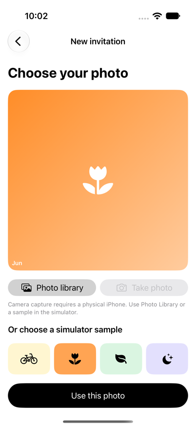

# Curio Round 1 — Progress Dialogue

Updated: November 19, 2026 (America/New_York)

This document records what Round 1 started with, what changed, what failed, how those problems were addressed, and which parts are intentionally temporary. It is a development handoff, not a claim that the production Firebase or multi-iPhone version is complete.

## Screenshot documentation practice

For each significant visible UI change:

1. Capture the relevant simulator screen before editing when a reproducible before state is available.
2. Make and build the scoped change.
3. Reopen the same simulator state and capture the after screen.
4. Save both images in `docs/progress/screenshots/` with a date and descriptive name.
5. Add the pair to this document with the behavior tested, not only a visual description.

Small code-only fixes that do not change a screen may be recorded without screenshots. If a reliable before state cannot be recreated, the entry must say that instead of presenting a different state as the before image.

## What we started with

- A newly created Xcode project that initially appeared in Xcode's navigator without an active app target or scheme.
- A four-screen product direction: Home, Photo Form, Live Thread, and Saved Journal.
- A Firebase contract for Auth, Firestore, Storage, callable Functions, access rules, expiry, and concurrency, but no verified end-to-end Firebase integration in the iOS target.
- A browser reference flow and repository examples for camera, photo-library, Firebase, buttons, and storage.
- The decision to use the Firebase Emulator Suite, simulator-only signing, and two iOS simulators for the first acceptance pass.

## What has changed

### Xcode and simulator prototype

- Created a buildable SwiftUI app target and scheme.
- Added simulator accounts A–J and a local account switcher.
- Implemented the main Discover, Inbox, Mine, creation, thread, and journal flows using an in-memory fixture store.
- Added public/private presentation, nine-photo capacity, a ten-minute demonstration clock, sample reset controls, and local sample content.

### Photo flow

- Added Photo Library selection and physical-iPhone camera capture support.
- Added a mandatory square crop screen after choosing or taking a photo.
- The cropper supports drag and pinch-to-zoom and exports a normalized 1200×1200 JPEG.
- Redesigned the selection screen so the square preview, source controls, simulator samples, and confirmation button no longer overlap.
- Added prompt suggestions: “Match my photo!”, “Find this color!”, and “I want to see…”.
- Fixed prompt entry so it accepts continuous typing and enforces a 140-character limit.

### Inbox and thread behavior

- Changed Inbox from a general thread list into contributor-only activity.
- A user who has not contributed to a thread does not receive that thread's Inbox activity.
- Photo responses show a small square image on the left.
- Chat notifications show the thread's current photos in a miniature 3×3 grid, preserving empty slots up to nine.
- Activity rows reopen the related live thread or saved journal.

### UI corrections

- Constrained shared photo tiles to their parent card so imported photos cannot cover labels, navigation, or neighboring cards.
- Stabilized draft photo identity to stop SwiftUI from recreating the prompt form after each keystroke.
- Added a brief submit-arming delay after “Use this photo” to prevent the same tap from passing through and activating “Publish invitation” on the next screen.

## Errors found and how they were fixed

### Xcode showed zero targets and schemes

The `.xcodeproj` existed but was not the active open project. Opening the project as the active Xcode document exposed the app target and scheme so build tools could operate.

### The wrong user saw an Inbox thread

The saved-journal fixture incorrectly treated G · Iris as a contributor. The fixture membership was corrected, and the Inbox now filters activity by actual contribution.

### Selected photos overflowed the screen

The shared photo tile used sizing that could escape its parent when displaying a real image. It was changed to accept the proposed parent size and clip its contents.

### Crop view layout and interaction problems

Early crop verification found an overlay/frame problem. The crop geometry was constrained to safe available width, the background was made opaque, and drag/zoom behavior was rechecked.

### Prompt accepted only one character

The draft photo used a new UUID during view recomputation, which recreated the subtree and disrupted focus. The UUID is now stable state, and the prompt has explicit focus handling.

### Confirmation could accidentally publish

A tap near the bottom of “Use this photo” could land on the publish button after the screen changed. Publishing is now disabled for the first 0.4 seconds after confirmation.

#### Simulator evidence — submit guard

Before tapping “Use this photo”:

After tapping the lower-center edge of the button:

The after state remains on “Ready to send?” and does not return Home or publish an invitation. This regression passed in the simulator after the guard was added.

## Temporary Round 1 implementation

The following pieces are demonstrations and must be replaced or completed before calling the app production-ready:

- Accounts A–J are local simulator identities, not Firebase Auth users.
- Threads, photos, messages, notifications, following, and time advancement are held in memory and reset when the fixture resets or the app process is recreated.
- The public/private picker currently demonstrates UI intent; production follower relationships, invitation redemption, viewer grants, and security enforcement are not implemented.
- Inbox notifications are derived locally from fixture thread state. They are not persisted Firestore notification documents and do not use APNs push notifications.
- The 3×3 notification grid has been verified with a full fixture; a partial real-data fixture should still be used to visually verify empty slots.
- Camera capture requires a physical iPhone. The simulator uses Photo Library or symbolic sample images.
- “Advance 10 min” is a simulator test control, not a production clock or server-enforced deadline.
- Accepted-photo immutability and the ninth-slot competition are represented by local behavior only; they still require transaction-safe callable Functions and Firestore rules.
- Firebase packages may be resolved in `Package.resolved`, but the app does not yet have a verified, end-to-end Firebase repository connected to emulator services.
- No online Firebase project configuration, App Check, APNs configuration, or real-device network-host setup is complete.

## Work to return to next

1. Link and verify the Firebase SDK products on the app target.
2. Add environment configuration for simulator emulator hosts, local-network physical iPhones, and production Firebase.
3. Replace the in-memory store with Auth, Firestore listeners, Storage uploads, and callable Functions while retaining a preview/demo repository.
4. Implement following, private invitations, redemption, and viewer grants as server-authoritative data.
5. Implement transaction-safe ninth-slot acceptance, ten-minute server deadlines, idempotency, retry behavior, and immutable accepted photos.
6. Add Firestore and Storage rules, indexes, emulator seed scripts, and automated backend acceptance tests.
7. Run the A/B exchange plus ten-account, private-access, concurrency, expiry, and retry tests on two simulators.
8. Test the network-host configuration with two physical iPhones before switching to online Firebase.
9. Create the short acceptance recording and final report with exact emulator start and seed commands.

## Current verification status

- Xcode compiler diagnostics for the edited SwiftUI file report no issues.
- The active Xcode project builds successfully.
- Simulator checks passed for the redesigned photo screen, prompt suggestions, continuous typing, contributor Inbox activity, the 3×3 chat grid, square crop behavior, and bounded Home photo cards.
- The accidental-publish regression passed: a lower-edge tap opened “Ready to send?” without publishing or returning Home.
