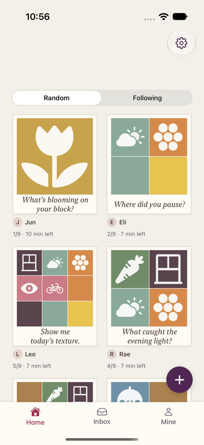
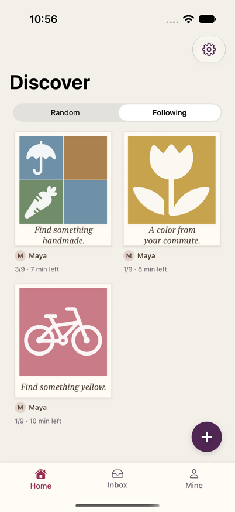
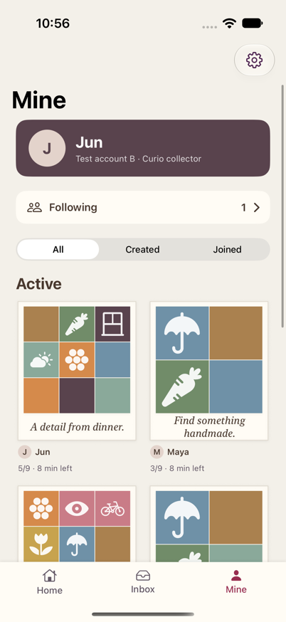
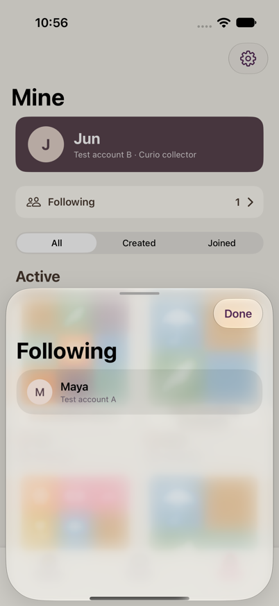

# Curio current UI flow audit — November 19, 2026

Scope: the current local SwiftUI simulator build. This report distinguishes visible fixture behavior from Firebase-backed Round One acceptance.

## Build status

**Working:** The active Xcode project builds successfully with no compiler diagnostics in the edited Discover, fixture, and Polaroid files.

## Evidence screenshots

### Discover — Random

**Working:** Random is the default. The two-column feed scrolls, cards remain bounded, and the simulator measured approximately 167 pt cards with a 14 pt gap. The small outer-inset variance comes from the simulator's rendered content coordinate space.

### Discover — Following

**Working for local fixtures:** B/Jun sees exactly three open Maya/A threads and no threads from unfollowed creators.

### Mine

**Working:** Mine shows the profile header, role filter, Active/Saved sections, and B's local Following count of one.

### Mine — Following list

**Working for local fixtures:** B's Following sheet lists only Maya, test account A.

## Flow results

| Flow | Status | Current result |
|---|---|---|
| Launch and build | Working | App builds and opens on Discover. |
| Discover Random/Following | Working locally | Random shows open fixtures; B's Following shows only Maya/A. Following data is not persisted. |
| Settings account menu | Working locally | The top-right gear opens A–J and showed B selected during the audit. These are in-memory identities, not Firebase Auth sessions. |
| Scenario account roles | Working locally | Simulator verification confirmed all A–J role labels and switching to C updates Mine to `Rea` and `C · Test join invitation`. |
| Discover Polaroid layout | Working with placeholders | Shared 1-up, 2×2, and 3×3 collage logic is visible. Fixtures use colors/SF Symbols rather than bundled sample JPGs. |
| Deadline frame color | Implemented; limited visual audit | Active paper interpolates toward `#502653` near expiry, including compact thumbnails. A timed before/after capture remains to be recorded. |
| Inbox rows | Partially working | One row per contributed thread shows a 55 pt collage, prompt, latest activity, and relative time. A vertical center line appears because the row `Divider` resolves vertically. |
| Inbox membership | Working locally | Only locally contributed threads produce Inbox rows. Backend delivery/read state is absent. |
| Mine filters | Implemented; not fully exercised | All / Created / Joined controls and Active / Saved sections exist, but all three filters were not walked in the latest session. |
| Mine Following list | Working locally | B shows Maya/A. Follow/unfollow mutation and Firebase persistence are absent. |
| Photo selection and crop | Previously verified; not rerun on latest build | Library/camera handoff, square crop, preview, prompt suggestions, and continuous typing passed earlier checks. |
| Final-submit protection | Previously verified | “Use this photo” opens preview without publishing; the final publish/join button requires a separate tap. It was not rerun after the latest feed-only changes. |
| Visitor invitation detail | Partially implemented | A nonmember can see summary and Add a photo. Private viewer authorization is not enforced. |
| Member timeline | Not meeting current direction | The current thread still separates photos from messages and does not yet interleave automatic photo-join entries and chat chronologically; outgoing/incoming bubble alignment remains unfinished. |
| Ten-minute archive | Partially working locally | The simulator control expires active fixtures and routes them into Mine, but this is not server time and the latest session did not complete the archive walk. |
| Personalized journal | Partially implemented | Existing cover logic centers the viewer's photo and leaves empty slots, with member conversation disclosure. A/B comparison was not rerun on the latest build, and Journal still needs the shared Visual Guide styling pass. |
| Full 9/9 removal | Implemented locally; not latest-session verified | Discover filters `isFull`; concurrency-safe ninth-slot acceptance is not implemented. |
| Public/private access | Not working securely | The picker and `isPrivate` field exist, but private discovery filtering, follower delivery, link redemption, viewer grants, Firebase Auth, and Firestore/Storage enforcement are absent. |
| Real multi-user synchronization | Not working | State remains in memory; two simulators do not share Firebase-backed updates. |

## Known visual issues

1. Inbox draws a thin vertical center line. Replace the row's `Divider` overlay with an explicitly horizontal one-point rectangle.
2. Native fixtures do not show the repository's sample photos because `imageData` is nil; only stable color/SF Symbol placeholders appear.
3. Thread and Journal screens still mix older system styling with the new Curio paper system.

## Next verification pass

Use a fresh device session to complete create → crop → preview → final publish, switch to B and join, exchange messages, fill/seed 9/9, advance to expiry, and compare A/B personalized journal centers. Capture the missing timed deadline-frame before/after evidence during that pass.
